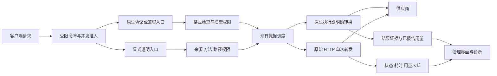

# API-Load 2.1 产品与结构审视

API-Load 保留原生适配，并增加独立透明 HTTP 选项。[透明转发说明](transparent-forwarding-proposal.md)记录实现契约；本文记录问题、设计取舍和验证范围，操作流程见[通用运维指南](operations.md)。

设计核验日期为 2026-10-28。公开记录只包含实现和合成验证，不包含个人部署状态、连接配置或账号清单。当前源码准备 2.1.2 候选版本，源码版本不表示公共镜像已经发布。

## 设计判断

现有 Go、Gin、GORM、Bifrost 和 Vue 可以继续承载个人网关。当前主要问题出现在模块之间的权限、证据和配置语义，以及界面把不同任务挤在一起。整套更换框架会增加凭据、协议和升级兼容成本，本轮重构这些实际出现问题的部分。

请求执行保持明确顺序。

协议适配负责实际输入输出，调度负责从当前允许的来源中选择凭据。能力信息可以帮助管理员判断，不能替代运行时权限检查。价格只解释消耗估算，未知价格也不能自动变成零价或余额。

界面按管理员的工作组织。先选择来源并保存凭据，在“服务与验证”检查具体方法、路径和格式，再为下游限制令牌的分组、协议与型号。遇到失败时，从请求证据回到具体日志。型号编辑继续独立保存，避免查看能力时意外改写调用 ID。

## 本轮已处理

| 方面 | 确认的问题 | 实现与影响 |
| --- | --- | --- |
| 界面结构 | 能力列表夹在窄侧栏，和调度编辑共用滚动区域 | 改为主区域独立页签，支持直接链接、型号筛选和请求日志跳转；保留原有品牌、图标、色彩与控件 |
| 刷新行为 | 修改型号、配置或点击页面刷新，服务证据没有一起失效 | 使用统一 API 模块与查询键，关联刷新和配置保存 |
| 语言与语义 | 原组件只有中英分支；无请求记录与型号未知混用 | 三语文案分别说明原生路径、供应商声明和近期请求，使用“暂无请求记录”表示账号证据缺失 |
| 令牌操作 | 权限摘要把布尔值当数组展开，保存会失败；旧版比较还遗漏空分组限制 | 逐字段规范化权限，保留新资源标志与已有分组限制，界面保存后实际回读验证 |
| 文件任务 | 模型受限令牌不能上传无 model 文件，另一个令牌上传的文件又不能引用 | 新增显式 `allow_model_less_resources`，默认关闭；同令牌可管理资源，生成仍按型号限制 |
| 热路径性能 | 每次上游尝试扫描全部分组计算共享限制 | 在配置快照生成时汇总，执行读取有效值；每次计算从 O(分组数) 变为 O(1) |
| 配置解释 | 高级配置显示单组数值，实际执行同账号最小值 | 管理 API 返回真正生效的共享限制，保留原覆盖值用于编辑 |
| 验证证据 | 普通聊天占满 200 条窗口，检索记录被挤掉 | 数据库先筛选相关记录，稳定排序，明确是否截断；窗口服从实际日志保留天数 |
| 请求语义 | 证据描述原请求，未反映分组参数覆盖 | 改为记录准备完成的实际外发请求，模态和维度不会继续显示被覆盖前的值 |
| 数据可靠性 | 异步日志复制遗漏单位指针与证据指针 | 深拷贝新增字段，防止排队后被原调用者改写 |
| 诊断隐私 | 目录失败日志仍直接输出上游 Summary | 只记录固定类别、状态与阶段；目录分页超限明确为格式错误，不换 key 从头抓取 |
| 音频 | PCM 字节恰好匹配压缩魔数时误报 | 吸收上游针对音频的修复，保留旧 Mistral 和 Soniox 协议权限 |
| 内存 | 小容器仍允许固定 128 MiB 请求，重写时还有多份缓冲 | 吸收 cgroup 内存探测与请求上限，覆盖入口、参数覆盖、脱敏及自动模型路径；超过上限返回 413 |
| 非法维度 | Cohere 负数维度能进入日志，使管理页面解析失败 | 新请求在入口拒绝非法维度；界面仍可显示已有负数失败记录，不替换成零 |
| 发布 | 版本、README、镜像引用不同步；预发布可能覆盖稳定标签 | VERSION 准备 2.1.2 候选版本，发布前校验标签与版本，候选不更新稳定 `:2` |

上游取舍、提交来源和发布测试见 [上游审阅](v2.1-upstream-review.md)。上游批量定价迁移与本项目 0031 冲突，未直接合并。默认记录请求体的改动也未采用。

## 权限与兼容边界

旧令牌的资源授权默认关闭，旧分组和原调用 ID 不重命名。新授权只放行 `native-services` 的无 model 文件及资源管理操作，仍受分组、协议、凭据身份和同令牌归属限制。带 model 的任务创建不能跳过型号过滤。

这个授权允许管理同令牌已经创建的资源。之后缩小型号列表不会自动收回这些资源的管理权限，关闭资源授权才会重新阻止无 model 操作。界面已明确说明，不暗示资源查询仍逐次按当前型号列表检查。

OpenAI Embeddings 的负 dimensions 透传是原有明确测试契约，本轮保留。Cohere 的显式 output_dimension 要求正的 JavaScript 安全整数，不按型号名称猜测可选维度；具体型号是否接受该数值仍由供应商判断。

小内存环境的请求上限会收紧。上限为可用内存的 1/14，限制在 16–128 MiB，未知内存仍为 128 MiB。512 MiB 容器约为 36.57 MiB。启动环境已有 GOMEMLIMIT 时不覆盖；自动 Go 限额是软限制，不能当作进程 RSS 或并发硬上限。

2.1 的授权标志沿用现有 JSON，不需要新的迁移。启用接口不会自动改变下游模型选择、维度、索引或知识库。

## 界面实走记录

审视使用隔离数据库和合成凭据，没有把生产凭据放进浏览器。

1. 分组详情和原能力折叠区。原页面可操作，但接口和型号信息集中在窄侧栏，展开后需要独立滚动。截图为 `01-before-capabilities.png`。
2. 型号编辑抽屉。既有调用 ID 与别名分开，保存具有明确边界，保留该结构。截图为 `02-models.png`。
3. 新“服务与验证”页签。接口方法和输入输出在主区显示，搜索与展开型号实际可用，凭据列表不会同时占据主区。截图为 `03-after-services.png`。
4. 合成令牌授权。默认关闭，界面开启并保存后，列表出现资源管理权限标签，后台回读为 true。截图为 `04-resource-permission.png`。

合成界面检查覆盖这些流程的可见标签、保存和回读结果，未宣称完成全部设备、屏幕阅读器或 WCAG 验收。

## 后续设计与未完成范围

| 优先级 | 工作 | 实施条件与边界 |
| --- | --- | --- |
| 高 | 文件与异步任务归属持久化 | 源码已实现，尚未发版。迁移 0033 新增 `resource_bindings`，记录访问令牌、凭据和身份版本，到期时间沿用 30 天。内存未命中时回查数据库，读库失败返回 503；写库失败只记日志，归属退回仅在内存。升级后首次启动会把停机 checkpoint 中的资源归属写入数据库。Responses 续聊 ID 仍只在内存和 checkpoint 中。仍不读取供应商账号的全部文件 |
| 高 | 异步任务最终用量 | 区分提交、执行、下载和最终账单，按资源 ID 幂等结算。供应商未报告的时长、页数和金额继续未知，轮询不能重复记账 |
| 高 | 长期能力验证记录 | 当前证据随请求日志过期。后续按凭据身份、型号、格式和实现版本保存有限验证摘要，与私人内容分离，不把旧通过永久当作可用 |
| 中 | 来源、账号与凭据进一步分开 | 当前共享账号标识已能限制资源；新账号实体应允许人工归属及共享配额。没有可靠元数据时不得自动把多把 key 视为多个账号 |
| 中 | 非 token 价格编辑及统计 | 按图片、时长、页数、调用次数独立建单位。上游迁移必须重新编号并验证生产副本，不能覆盖现有手工价格 |
| 中 | 单项管理资源接口 | 访问令牌详情仍通过集合分页定位。应新增精确读取入口，并复用现有权限与用量聚合，减少大列表扫描 |
| 按使用需求 | NVIDIA、Cloudflare、OpenRouter 特殊协议和实时语音 | 以真实账号与官方协议分别实现，不用通用兼容入口冒充完整支持；收费和质量验收需单独确定范围 |
| 按部署需求 | 多副本共享限额与后台任务锁 | 单实例可以继续使用内存准入。多副本需要共享计数及幂等任务所有权，不能只增加实例数 |

这些项目没有混入“已完成”。完全替换数据库、凭据调度器或前端框架目前没有足够收益依据。候选版优先修复已经找到并能够验证的问题，再按真实使用频率推进上述功能。
